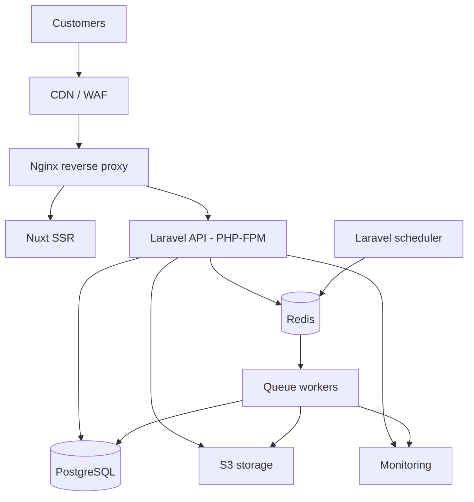

# GulfCart — Infrastructure and Deployment

No Kubernetes at this stage. A single region, Docker-based deployment is enough for launch;
the modular monolith scales horizontally by adding API and worker containers.

## 1. Topology



Hosting region and data residency are decided together with the company jurisdiction
(see `COUNTRY_CONFIGURATION.md`). Prefer a region in the GCC for latency.

## 2. Docker Compose (development baseline)

```yaml
services:
  nginx:
    image: nginx:1.27-alpine
    ports: ["80:80"]
    volumes: ["./infrastructure/nginx/default.conf:/etc/nginx/conf.d/default.conf:ro"]
    depends_on:
      api: { condition: service_healthy }
      storefront: { condition: service_started }

  api:
    build: { context: ./apps/api, target: dev }
    env_file: ./apps/api/.env
    environment: { DB_HOST: postgres, REDIS_HOST: redis }
    healthcheck:
      test: ["CMD", "php", "artisan", "app:health", "--ready"]
      interval: 10s
      retries: 5
    depends_on:
      postgres: { condition: service_healthy }
      redis: { condition: service_healthy }

  worker:
    build: { context: ./apps/api, target: dev }
    command: php artisan queue:work redis --queue=procurement,payments,outbox,notifications,default --tries=1 --max-time=3600
    env_file: ./apps/api/.env
    depends_on:
      api: { condition: service_healthy }

  scheduler:
    build: { context: ./apps/api, target: dev }
    command: php artisan schedule:work
    env_file: ./apps/api/.env
    depends_on:
      api: { condition: service_healthy }

  storefront:
    build: { context: ./apps/storefront, target: dev }
    environment: { NUXT_PUBLIC_API_BASE: http://localhost/api/v1 }

  postgres:
    image: postgres:17-alpine
    environment:
      POSTGRES_DB: gulfcart
      POSTGRES_USER: gulfcart
      POSTGRES_PASSWORD: ${POSTGRES_PASSWORD:-gulfcart_dev_only}
    volumes: [postgres_data:/var/lib/postgresql/data]
    healthcheck:
      test: ["CMD-SHELL", "pg_isready -U gulfcart -d gulfcart"]
      interval: 5s
      retries: 10

  redis:
    image: redis:7-alpine
    command: redis-server --appendonly yes
    volumes: [redis_data:/data]
    healthcheck:
      test: ["CMD", "redis-cli", "ping"]
      interval: 5s
      retries: 10

  mailpit:
    image: axllent/mailpit
    ports: ["8025:8025"]

volumes:
  postgres_data:
  redis_data:
```

The dev password default is for local use only. Before production add: private networks,
Docker secrets or a secret manager, TLS termination, resource limits, log shipping,
backups, and non-root containers.

## 3. Environment configuration

```env
APP_ENV=production
APP_DEBUG=false
APP_URL=https://api.gulfcart.com
FRONTEND_URL=https://gulfcart.com
SANCTUM_STATEFUL_DOMAINS=gulfcart.com,www.gulfcart.com

DB_CONNECTION=pgsql
DB_HOST=postgres
DB_PORT=5432
DB_DATABASE=gulfcart
# DB_USERNAME / DB_PASSWORD injected by the platform, never committed

REDIS_HOST=redis
REDIS_PORT=6379
QUEUE_CONNECTION=redis
CACHE_STORE=redis
SESSION_DRIVER=redis

FILESYSTEM_DISK=s3
LOG_CHANNEL=stderr
LOG_FORMAT=json

DEFAULT_COUNTRY=AE
SUPPORTED_COUNTRIES=AE,SA
DEFAULT_CURRENCY=AED
SUPPORTED_CURRENCIES=AED,SAR
DEFAULT_LOCALE=en
SUPPORTED_LOCALES=en,ar
```

Commit only `.env.example`. Database passwords and supplier keys never go into Git.

## 3.1 Variables added in Sprints 1–5

| Variable | Default | Purpose |
|---|---|---|
| `CATALOG_DISK` | `public` | Product images disk (`s3` in production) |
| `CORS_ALLOWED_ORIGINS` | `FRONTEND_URL` | Comma-separated storefront origins (credentials allowed) |
| `PAYMENT_PROVIDER` | `sandbox` | Payment gateway; sandbox refused in production |
| `PAYMENT_SANDBOX_SECRET` | dev value | HMAC secret for sandbox webhooks |
| `PAYMENT_FEE_PERCENT` | `2.9` | Gateway fee used in pricing |
| `FX_BUFFER_PERCENT` / `FX_MAX_AGE_HOURS` | `1.5` / `24` | FX buffer; prices expire with stale rates |
| `QUOTE_VALIDITY_MINUTES` / `ORDER_PAYMENT_WINDOW_MINUTES` | `30` / `60` | Checkout lock and payment window |
| `PROCUREMENT_MAX_COST_INCREASE_PERCENT` | `5` | Cost tolerance before an exception |
| `OPERATIONS_ALERT_EMAIL` | — | Procurement exception alerts |
| `ALLOW_MOCK_SUPPLIER_IN_PRODUCTION` / `ALLOW_SANDBOX_PAYMENTS_IN_PRODUCTION` | `false` | Keep false |

Operations, scheduled jobs and incident playbooks: [`OPERATIONS.md`](OPERATIONS.md).

## 4. Environments

| Environment | Purpose | Data |
|---|---|---|
| local | Developer machines, Docker Compose | Seeders + factories |
| ci | GitHub Actions service containers | Ephemeral |
| staging | Pre-production, payment sandbox, mock and sandbox suppliers | Anonymised |
| production | Live | Real |

## 5. Release process

1. PR → CI green → review → merge to `main`.
2. Build immutable images tagged with the commit SHA.
3. Deploy to staging, run migrations, run smoke and E2E tests.
4. Manual approval → production deploy; migrations must be backward compatible
   (expand/contract) so API containers can roll without downtime.
5. Workers are restarted gracefully (`queue:restart`) after deploy.

## 6. Production hardening checklist

- [ ] TLS everywhere, HSTS
- [ ] WAF and CDN in front of Nginx
- [ ] PostgreSQL managed or replicated, daily backups + PITR, restore tested
- [ ] Redis with AOF persistence and memory limits
- [ ] Separate DB roles: app (DML), migrations (DDL), read-only analytics
- [ ] Horizon or equivalent queue monitoring
- [ ] Centralised logs, metrics and alerting
- [ ] Error tracking with PII scrubbing
- [ ] Resource limits and restart policies
- [ ] Secrets in a secret manager, rotated
- [ ] Load test passed (catalog and concurrent checkout)
