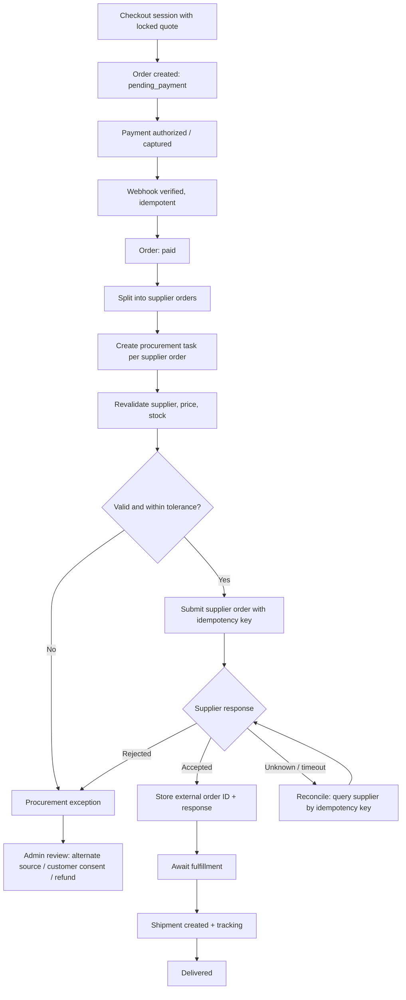

# GulfCart — Order, Procurement and Fulfillment Workflow

This is the most critical workflow in the system. Every rule here is mandatory.

## 1. End-to-end flow



## 2. Order creation and splitting

1. `POST /checkout` creates a `checkout_session` with a locked quote (expires after
   `quote_validity_minutes`, default 30).
2. `POST /orders` (with `Idempotency-Key`) in **one DB transaction**:
   - verifies the checkout session is valid and not expired,
   - creates `orders` (status `pending_payment`) with totals copied from the quote,
   - creates `order_items` with immutable product, price and cost snapshots, including the
     exchange rate used,
   - writes an `OrderCreated` outbox event.
3. Payment succeeds (verified webhook). In one transaction: payment `captured`, order `paid`,
   `OrderPaid` outbox event.
4. The `OrderPaid` handler groups order items by `supplier_product.supplier_id` and creates
   one `supplier_orders` row per supplier (unique on `order_id, supplier_id`), its
   `supplier_order_items`, and one `procurement_tasks` row each.

Example: Dress (Supplier A), Shoes (Supplier B), Bag (Supplier A) produces customer order
`GC-10001`, supplier orders `SO-10001` (A: dress, bag) and `SO-10002` (B: shoes), and two
shipments. The customer sees one order with a "ships in 2 packages" notice.

## 3. Procurement rules

1. Never purchase before payment is captured and the order is `paid`.
2. Revalidate price and stock with the connector immediately before purchase.
3. Price tolerance: if the new supplier cost raises landed cost by more than
   `procurement.max_cost_increase_percent` (default 5%) **or** pushes the contribution margin
   below the rule's `min_margin_percent`, do not buy. Raise an exception. GulfCart absorbs
   increases within tolerance; the customer is never charged more without explicit consent.
4. Idempotency key per supplier order: `so_{supplier_order_id}_v{n}`. `n` increments only when
   an operator explicitly creates a new purchase after confirming the previous one did not
   happen. The key is unique in the database.
5. Store the raw supplier request and response (secrets redacted) in `procurement_attempts`.
6. Never blindly retry a purchase whose outcome is unknown (timeout, 5xx after send).
   First **reconcile**: ask the supplier for orders by idempotency key or client reference.
7. Retry only errors classified as safe (connection refused before send, 429, explicit
   "not processed"). Backoff: 1 min, 5 min, 15 min, 1 h, 4 h; then exception.
8. On final failure: try an alternate authorized source (same variant, within tolerance),
   otherwise offer the customer a replacement or start a refund for the affected items.
9. Concurrency: a worker claims a task with `SELECT ... FOR UPDATE SKIP LOCKED` and sets
   `locked_at`/`locked_by`; stale locks (> 10 min) are released by the scheduler.
10. Suppliers without an authorized connector use **manual procurement**: the task appears in
    the admin queue; an operator places the order and records the external order ID,
    cost and evidence. Same state machine, same audit trail.

## 4. Duplicate delivery example

```text
Message 1: supplier order SO-1001, key so_1001_v1  -> purchase executed, result stored
Message 2: supplier order SO-1001, key so_1001_v1  -> existing result returned
Total purchases = 1
```

Laravel `ShouldBeUnique` alone is not enough. Guarantees come from, in order:
(1) supplier order status checked under row lock, (2) unique idempotency key in DB,
(3) idempotency key sent to the supplier where supported.

## 5. Supplier Connector contract

```php
<?php

namespace App\Modules\Procurement\Contracts;

use App\Modules\Procurement\Contracts\Data\{
    AvailabilityResult, ConnectorCapabilities, ExternalProduct,
    PurchaseRequest, PurchaseResult, SupplierOrderStatus,
    SupplierQuote, TrackingInfo, CancellationResult, QuoteRequest
};

interface SupplierConnectorInterface
{
    public function capabilities(): ConnectorCapabilities;

    public function getProduct(string $externalProductId): ExternalProduct;

    public function checkAvailability(string $externalProductId, string $externalVariantId): AvailabilityResult;

    public function getQuote(QuoteRequest $request): SupplierQuote;

    public function createOrder(PurchaseRequest $request, string $idempotencyKey): PurchaseResult;

    /** Used for reconciliation after an unknown outcome. Returns null if not found. */
    public function findOrderByReference(string $idempotencyKey): ?SupplierOrderStatus;

    public function getOrderStatus(string $externalOrderId): SupplierOrderStatus;

    public function getTracking(string $externalOrderId): TrackingInfo;

    public function cancelOrder(string $externalOrderId): CancellationResult;
}
```

Typed DTOs replace raw arrays so that every connector returns the same shape.
`PurchaseResult` has an outcome of `accepted`, `rejected` or `unknown`.
`capabilities()` declares support for idempotency, cancellation, tracking and webhooks.

Implementations:

```text
SupplierConnectorInterface
├── MockSupplierConnector       # configurable: success, reject, timeout, price change, OOS
├── ManualSupplierConnector     # routes tasks to the admin queue
└── Authorized<Name>Connector   # added only after written authorization
```

A connector resolver picks the implementation from `suppliers.connector_type`. A supplier
can be activated only when `commercial_authorization_status = approved` and a valid
`supplier_authorizations` record exists.

> Do not assume SHEIN, Temu, Amazon or any marketplace provides a commercial API that allows
> automated resale purchasing. Each connector is enabled only after access, resale and
> direct-shipping rights are proven in writing.

## 6. State machines

### 6.1 Order (customer-facing aggregate)

```text
pending_payment -> paid -> processing -> partially_shipped -> shipped -> delivered -> completed
pending_payment -> payment_failed | expired | cancelled
paid | processing -> cancelled (before any supplier purchase) -> refunded
any post-paid state -> partially_refunded | refunded
```

`processing`, `partially_shipped`, `shipped` and `delivered` are **derived** from the
supplier orders and shipments, recalculated by a single `OrderStatusAggregator`.

### 6.2 Supplier order

```text
pending -> procurement_pending -> submitting -> purchased -> supplier_processing
        -> shipped -> delivered
submitting -> unknown -> (reconcile) -> purchased | failed
procurement_pending | submitting -> failed -> exception
exception -> procurement_pending (alternate source / approved retry) | cancelled
purchased | supplier_processing -> cancel_requested -> cancelled
```

### 6.3 Rules

- Transitions are defined in one class per entity; anything else throws `IllegalTransition`.
- Out-of-order events (e.g. `shipped` arriving before `purchased`) are stored in
  `supplier_webhook_events` with status `deferred` and replayed after reconciliation.
- Every transition writes an audit entry and an outbox event.

## 7. Exceptions dashboard

Admin `/admin/procurement` shows tasks by status with: order number, supplier, age, attempts,
last error, cost delta, and actions: retry (only if eligible), approve manual purchase,
switch source, cancel and refund. Every action requires a permission and is audited.

## 8. Reconciliation

- Scheduler every 15 minutes: supplier orders in `submitting`/`unknown` older than 5 minutes
  are reconciled.
- Daily: compare all supplier orders from the last 30 days against supplier status;
  report mismatches (charged but not recorded, recorded but not charged).
