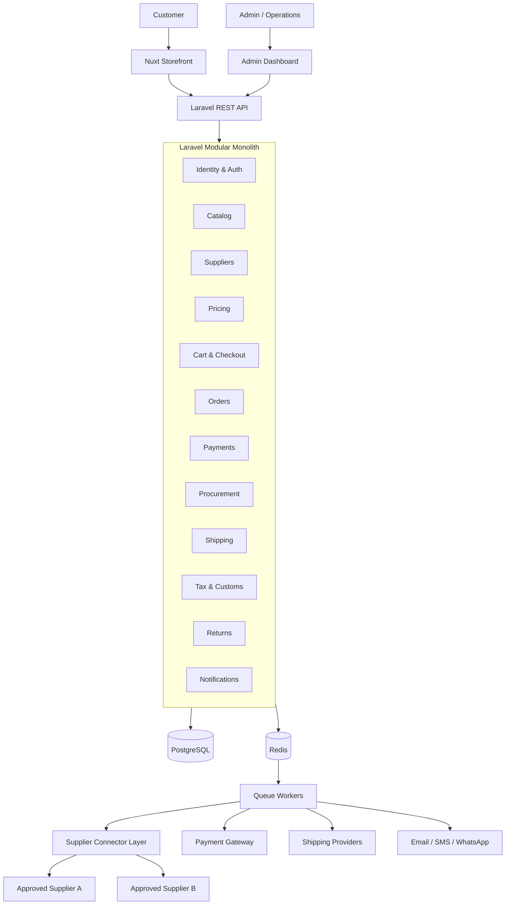
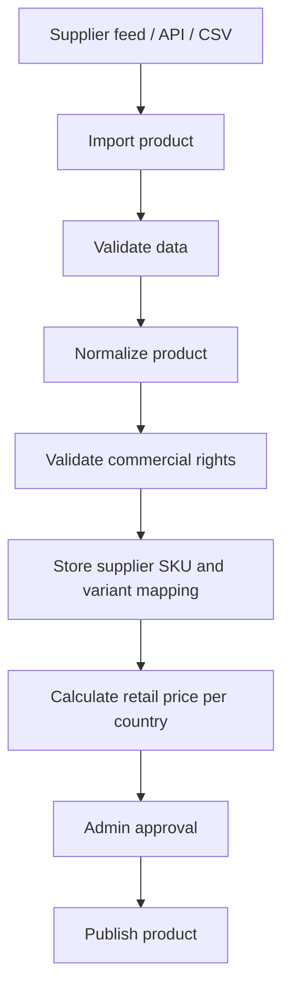

# GulfCart — Technical Specification

Version 1.0 · Status: baseline

## 1. Architectural decisions

- GulfCart is the seller to the customer, not an affiliate or referral intermediary.
- Each product has one or more purchase sources, each with its own cost.
- One order can split into several supplier orders and shipments.
- Purchasing is automated only through approved Supplier Connectors. No unauthorized
  browser automation or scraping.
- AE and SA launch together, so tax, shipping and import settings are separated per country.
- The legal entity's jurisdiction is not assumed anywhere in code (see `SPEC_REVIEW.md`).

## 2. System architecture



The admin dashboard is a separate Nuxt layout (`/admin`) in the same Nuxt app for the MVP,
behind staff authentication and MFA. It can be split into its own app later without API changes.

## 3. Modules

| Module | Responsibility | May depend on |
|---|---|---|
| Identity | Authentication, MFA, roles, permissions | Shared |
| Countries | Country, currency, locale configuration | Shared |
| Audit | Administrative activity log | Shared, Identity |
| Catalog | Products, categories, variants, images, availability | Countries |
| Suppliers | Suppliers, authorizations, supplier products, mappings, imports | Catalog |
| Tax | VAT and customs rules | Countries |
| Pricing | Cost, FX, markup, margin, retail price | Catalog, Suppliers, Tax, Countries |
| Shipping | Methods, quotes, shipments, tracking | Countries |
| Cart | Shopping cart | Catalog, Pricing |
| Checkout | Address, shipping option, quote, checkout session | Cart, Pricing, Shipping, Tax |
| Orders | Order lifecycle and splitting | Checkout, Suppliers |
| Payments | Intents, capture, webhooks, refunds | Orders (via contract) |
| Procurement | Supplier purchases, connectors, reconciliation | Orders, Suppliers |
| Returns | Returns and refund requests | Orders, Payments |
| Notifications | Email, SMS, WhatsApp | listens to events only |
| Analytics | Sales and profitability | listens to events, read models |

Dependencies point downward only. Upward communication (for example, Payments telling
Orders that a payment succeeded) happens through domain events via the outbox.

### Module layout

```text
app/Modules/<Module>/
├── Contracts/        # public interfaces other modules may use
├── Domain/           # entities, value objects, state machines, domain services
├── Application/      # actions / use cases, DTOs
├── Infrastructure/   # Eloquent models, repositories, external clients
├── Http/             # controllers, Form Requests, API Resources, routes.php
├── Events/           # domain events published by the module
├── Listeners/
├── Jobs/
├── Database/         # module migrations, factories, seeders
├── Providers/        # <Module>ServiceProvider registers routes, bindings, events
└── Tests/            # or tests/Modules/<Module>
```

Use plain Laravel service providers per module (no third-party module package is required).
Enforce boundaries with an architecture test (Pest `arch()`), for example "Catalog must not
use `App\Modules\Orders`".

## 4. Project structure

```text
gulfcart/
├── apps/
│   ├── api/
│   │   ├── app/
│   │   │   ├── Modules/...
│   │   │   ├── Shared/        # Money, Idempotency, Outbox, ApiResponse, StateMachine
│   │   │   └── Providers/
│   │   ├── database/{migrations,seeders,factories}
│   │   ├── routes/
│   │   └── tests/
│   └── storefront/
│       ├── app/ components/ composables/ layouts/ pages/ services/ i18n/
├── infrastructure/{docker,nginx,monitoring}
├── docs/
└── docker-compose.yml
```

## 5. Core workflows

### 5.1 Product ingestion



Each product needs: internal product ID, supplier product ID, supplier SKU, title and
description (ar, en), images with usage rights, variants, cost price, availability,
delivery countries, estimated delivery time, and last synchronization timestamp.

A product can be published in a country only if: it has at least one active supplier
source from an **authorized** supplier that delivers to that country, at least one image
with `rights_status = approved`, a valid price for that country, and admin approval.

### 5.2 Procurement and order splitting

See [`PROCUREMENT_WORKFLOW.md`](PROCUREMENT_WORKFLOW.md).

### 5.3 Pricing

See [`PRICING_ENGINE.md`](PRICING_ENGINE.md).

## 6. Cross-cutting concerns

| Concern | Rule |
|---|---|
| Money | `App\Shared\Money` backed by `brick/money`; DB `NUMERIC(14,2)` for sale amounts, `NUMERIC(14,4)` for costs |
| Time | Store UTC (`TIMESTAMPTZ`); display in `Asia/Dubai` / `Asia/Riyadh` |
| IDs | UUID v7 (`HasUuids` with ordered UUIDs) for primary keys; prefixed public IDs in API (`prd_`, `ord_`) optional |
| Idempotency | `Idempotency-Key` header on financial endpoints; `idempotency_keys` table |
| Events | Transactional outbox, dispatched by a worker; consumers idempotent |
| State | Explicit state machines for orders, supplier orders, payments, shipments, refunds |
| Request IDs | `X-Request-Id` accepted or generated, returned in `meta.request_id` and in logs |
| i18n | Translatable fields stored as JSONB `{ "en": "...", "ar": "..." }` for catalog content |
| Config | Country, tax, shipping, pricing rules stored in DB and editable in admin, cached in Redis |

## 7. Related documents

- Database: [`DATABASE_SCHEMA.md`](DATABASE_SCHEMA.md)
- API: [`API_SPECIFICATION.md`](API_SPECIFICATION.md)
- Security: [`SECURITY_SPEC.md`](SECURITY_SPEC.md)
- Deployment: [`DEPLOYMENT.md`](DEPLOYMENT.md)
- Countries: [`COUNTRY_CONFIGURATION.md`](COUNTRY_CONFIGURATION.md)
