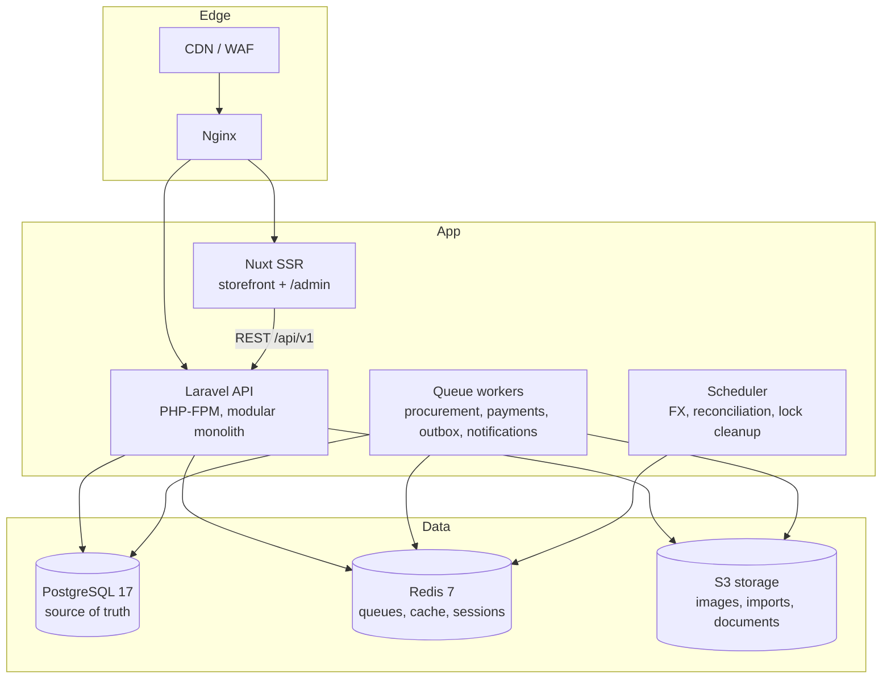

# Containers (C4 level 2)

| Container | Technology | Responsibility | Scales by |
|---|---|---|---|
| Nginx | nginx 1.27 | TLS termination (behind CDN), routing `/api` vs storefront | 1–2 instances |
| Nuxt | Nuxt (ADR-003), Node 22 | SSR storefront, admin SPA layout, i18n/RTL | Horizontal |
| API | Laravel 13, PHP 8.4 FPM | All HTTP endpoints, all modules | Horizontal |
| Workers | Same image as API | Queue jobs per named queue | Per queue |
| Scheduler | Same image as API | Cron-like tasks; exactly one instance | Single |
| PostgreSQL | 17 | Transactional data, outbox | Vertical + read replica |
| Redis | 7 | Queues, cache, sessions, locks; never financial truth | Vertical |
| S3 | S3-compatible | Images (public via CDN), private documents | Managed |
