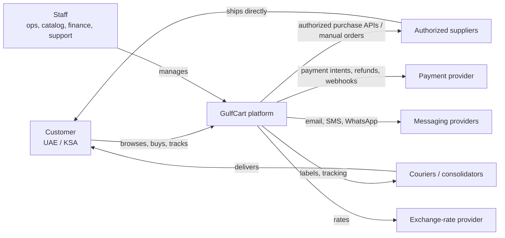

# System Context (C4 level 1)

| External system | Integration | Notes |
|---|---|---|
| Authorized suppliers | `SupplierConnectorInterface` | Only after written authorization; mock + manual until then |
| Payment provider | Hosted payment + webhooks | Must support AED, SAR, mada, Apple Pay (decision D2) |
| Couriers | Carrier adapters (Sprint 4) | Importer of Record arrangement required |
| Messaging | Notification channels | Templates in ar and en |
| FX provider | Scheduled fetch | Stale-rate alerting |
